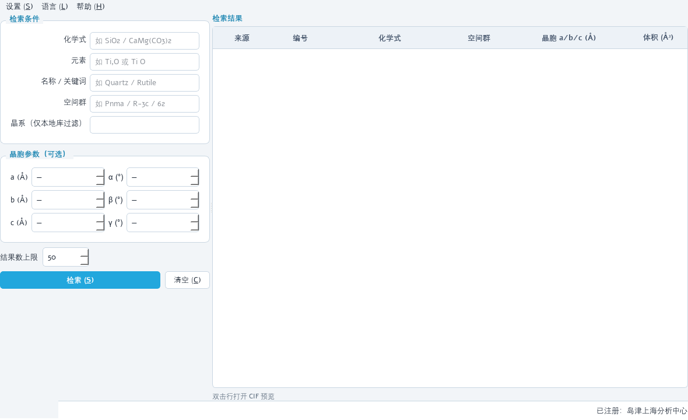
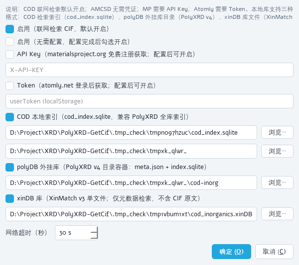
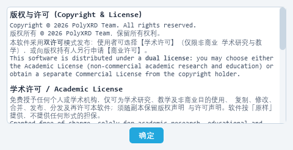

# PolyXRD GetCIF v1.3.0

**CIF 检索与获取小工具** —— PolyXRD 家族成员。单文件 exe 或安装包，双击即用，无需安装。

## 🖼️ 明亮模式预览（v1.3.0 离屏渲染）

| 主窗口 | 数据源设置 | 版权与许可 |
|---|---|---|
|  |  |  |

## 📦 发布形态（按需下载其一即可）

| 形态 | 资产 | 体积 | 注册机制 | 适用 |
|---|---|---|---|---|
| **标准版** | `PolyXRD-GetCIF.exe` | ~106 MB | ✅ | 单文件免安装；检索 / 预览 / 下载全功能，无 3D |
| **Plus 版** | `PolyXRD-GetCIF-Plus.exe` | ~269 MB | ✅ | 单文件免安装；含**应用内 3D 结构展示** + 完整 Qt |
| **内部评估版** | `PolyXRD-GetCIF-Internal.exe` | ~269 MB | ❌ 停用 | 内部评估自用；Plus 基底（含 3D），状态栏右侧固定显示「内部评估版本」 |
| **标准版安装包** | `PolyXRD-GetCIF-Setup.exe` | ~40-60 MB | ✅ | 正常安装流程（可选安装位置、快捷方式、卸载） |
| **Plus 版安装包** | `PolyXRD-GetCIF-Plus-Setup.exe` | ~100-120 MB | ✅ | 同上（含 3D） |

单文件版首次启动解压需数秒；安装包装入本机磁盘后**启动免自解压**，更快。

## ✨ v1.3.0 更新

### 明亮模式界面（跟随家族）

- 全局 QSS 由深海军蓝暗色改为**明亮模式**：浅灰蓝窗口底（`#F2F5F8`）+ 白色面板，强调色沿用 PolyXRD 家族青 `#22A7DD`（文字强调压深为 `#1783B0` 保证浅底可读性）；
- 应用内 3D 结构视口同步改为浅色（白底 + 深灰文字），与整体接口一致；
- 受影响处：主窗口 / 设置 / 预览 / 关于对话框、结果表标题、3D 渲染场景。

### 数据源兼容 polyDB 与 xinDB

设置 → 数据源设置新增两类本地库（均只读、可与其他源并用）：

| 库 | 形态 | 内容 | CIF 获取 |
|---|---|---|---|
| **polyDB 外挂库** | 目录容器（`meta.json` + `index.sqlite`，PolyXRD v4 的 polyDB v1 格式） | 化学式 / 元素 / 名称 / 空间群 / 晶系 / 晶胞检索 | ✅ 按 `cif_rel` 相对「数据根目录」解析原始 CIF |
| **xinDB 库** | 单文件 `.xinDB`（XinMatch v3 列存格式：`meta` / `entries` / `peak_chunks`） | 化学式 / 元素 / 名称 / 空间群 / 晶系（`crystal_system` 列直查）/ 晶胞检索 | ❌ 库内不含 CIF 原文，预览时给出明确提示并引导改用 COD 联网检索 |

- 判别逻辑与家族一致：polyDB 校验 `meta.json`（`format=polyDB`）+ `index.sqlite` 的 `entries` 表；xinDB 校验必需表与 `meta.schema_version=3`，校验失败在状态栏给出可读原因；
- **不加载 polyDB 二进制数组段 / xinDB 峰数据段**（纯 SQLite 标量检索），标准版同样可用，无需 numpy；
- 配置项落在 `settings.toml` `[local]` 节：`polydb_path` / `xindb_path`；开关 `polydb_enabled` / `xindb_enabled`（默认开，配置路径后生效，与 COD 本地索引同规则）。

### 帮助菜单：版权与许可

- 新增「版权与许可 (&L)」菜单项（与「关于」并列），展示家族统一的**双许可精简说明**（学术许可 / 商业许可，中英对照）+ 联系方式；完整条款见仓库 `LICENSE` / `LICENSE-CN`；
- 三语界面同步（en / ja 菜单项与文案随界面语言切换）。

### 其他

- 版本号 1.2.0 → 1.3.0；`getcif` 包新增 `__url__` / `__contact__` 家族元数据；
- 5 个 spec 的 hiddenimports 同步加入新适配器与 license_dialog。

## ✅ 发布前验证

- 离线自检 **62 项全过**：CIF 解析 / MP structure→CIF / COD 本地库 / **polyDB 12 项**（目录判别、化学式·空间群·晶系·名称过滤、cif_rel 取回、开关行为）/ **xinDB 10 项**（库判别、化学式·空间群·晶系·晶胞过滤、无 CIF 原文报错）/ **明亮模式与帮助菜单 5 项** / 3D 渲染 / 注册机制 / 内部评估版链路 / GUI 离屏冒烟；
- 运行方式：`tests/run_checks.py`（`--online` 附加联网检查）；
- 自检在独立临时配置目录中进行（`POLYXRD_GETCIF_CONFIG_DIR`），不读写用户真实 `settings.toml`。

## 📄 许可

双许可（学术 / 商业），详见 LICENSE 与 LICENSE-CN；帮助菜单「版权与许可」可随时查看精简说明。

## 🙏 数据源致谢

COD · AMCSD/RRUFF · Materials Project · Atomly 的公开数据服务。
本地库格式兼容 PolyXRD（polyDB v1）与 XinMatch（xinDB v3）。
